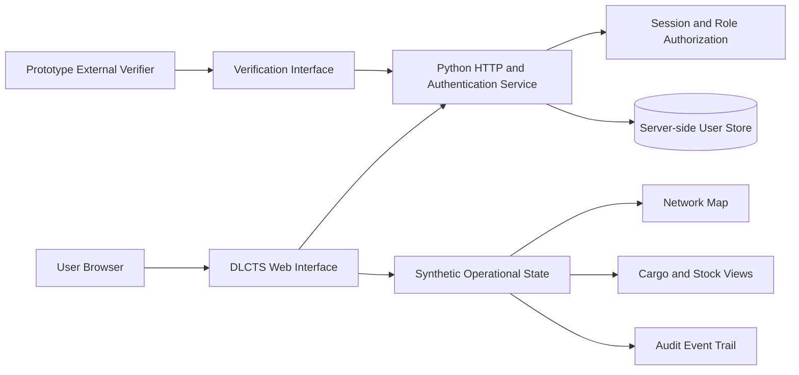
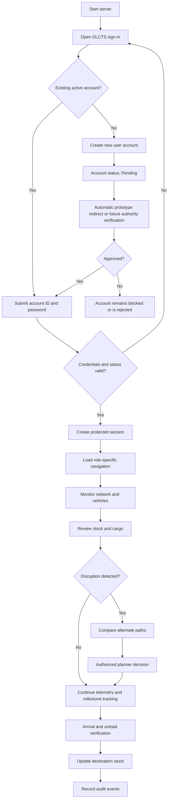
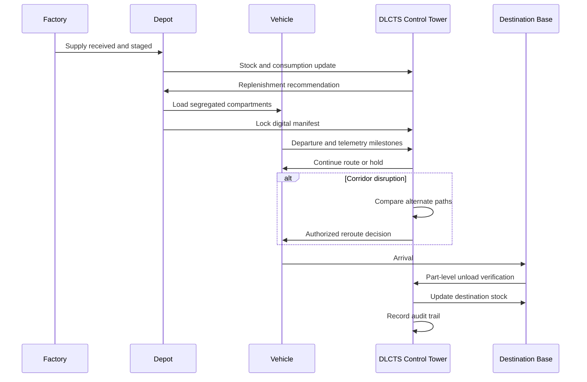

# Defence Logistics Control and Tracking System

DLCTS is a responsive logistics control-tower prototype for monitoring land-corridor activity, vehicle movement, cargo manifests, days-of-supply endurance, disruptions, rerouting decisions, unload verification, and operational audit events.

The application uses synthetic locations, non-classified coordinates, and simulated logistics records. It is intended for demonstration, academic review, and workflow validation only.

> [!WARNING]
> This repository is a local prototype, not a production defence system. Do not use it with classified information, real operational coordinates, production identities, or internet-facing deployments.

## Contents

- [Core Capabilities](#core-capabilities)
- [System Architecture](#system-architecture)
- [Complete Application Workflow](#complete-application-workflow)
- [Account and Verification Workflow](#account-and-verification-workflow)
- [Roles and Permissions](#roles-and-permissions)
- [Application Views](#application-views)
- [Operational Event Lifecycle](#operational-event-lifecycle)
- [Local Installation](#local-installation)
- [Demo Accounts](#demo-accounts)
- [Routes and APIs](#routes-and-apis)
- [Project Structure](#project-structure)
- [Security Model](#security-model)
- [Prototype Limitations](#prototype-limitations)
- [Future External Verification](#future-external-verification)
- [GitHub Upload Checklist](#github-upload-checklist)
- [Upload to GitHub](#upload-to-github)
- [Troubleshooting](#troubleshooting)

## Core Capabilities

| Capability | Current Prototype Behavior |
|---|---|
| Operational overview | Summarizes vehicles, strategic nodes, corridors, stock signals, disruptions, and recent events. |
| Live land network | Displays 10 strategic nodes, 15 corridors, vehicle markers, blocked routes, detours, and selected paths. |
| Vehicle search | Finds vehicles by ID, cargo, route, origin, destination, compartment, or status. |
| Custom path search | Accepts origin and destination nodes, avoids blocked corridors, and highlights an available path on the map. |
| Cargo verification | Tracks segregated compartments, locked manifests, part-level unload checks, and completed receipts. |
| Stock endurance | Displays stock, consumption, predicted days of supply, thresholds, and replenishment recommendations. |
| Disruption response | Presents blocked routes, affected vehicles, alternate corridors, planner approval, holding, and undo actions. |
| Audit trail | Records network, stock, cargo, transit, disruption, decision, verification, and access events. |
| Role-based access | Restricts views and sensitive actions according to the verified user role. |
| Account registration | Creates persistent pending accounts with protected passwords and requested roles. |
| Prototype verification | Redirects a newly registered user to an account-specific self-authentication page when prototype mode is explicitly enabled. |

## System Architecture



### Frontend

The main frontend is a dependency-free single-page application built with HTML, CSS, and JavaScript. It renders the authenticated control tower, operational views, interactive searches, manifests, decisions, and audit records.

### Authentication Service

`server.py` serves approved frontend files, handles login and registration, creates HttpOnly sessions, enforces role permissions for sensitive actions, persists new accounts, and optionally enables the prototype verification portal.

### User Store

New account records are stored in `data/users.json` by default. Passwords are never stored in plaintext. The user store is excluded from Git through the included `.gitignore`.

### Operational Data

The current operational dataset is synthetic and held in the frontend prototype. A production version should retrieve authorized operational records from protected backend APIs instead.

## Complete Application Workflow



## Six-Stage Logistics Workflow

### Stage 1: Network Initialization

The prototype initializes factories, ports, central depots, forward bases, and land corridors. The demonstration network contains 10 strategic nodes and 15 corridors with route status and capacity context.

### Stage 2: Supply Forecasting

The stock view combines current stock, daily consumption, and predicted endurance. It marks safe, watch, and critical conditions and presents an exact replenishment recommendation without automatically changing unrelated schedules.

### Stage 3: Compartment Loading

Food, medicine, war stores, fuel, and hazardous cargo are represented in segregated compartments. A digital manifest is locked after compatibility and loading confirmation.

### Stage 4: Live Vehicle Tracking

Active vehicles report route progress, ETA, milestones, next checkpoints, and telemetry freshness. Operators can search for a specific vehicle and inspect its route and compartments.

### Stage 5: Disruption Management

When a route becomes unavailable, affected vehicles enter operational review. Alternate corridors are compared by distance, ETA impact, corridor load, cargo constraints, and weather or hazard status. An authorized role must approve, hold, or undo the route decision.

### Stage 6: Unload Verification and Audit

At destination, cargo is confirmed part by part against the locked manifest. A complete receipt updates the destination stock state and creates verification and audit events.

## Account and Verification Workflow

### Existing User Sign-In

1. Start the application server.
2. Open `http://127.0.0.1:8000`.
3. Enter the assigned account ID and password.
4. The server validates the protected password record and account status.
5. An active account receives an HttpOnly session cookie.
6. The frontend loads only the views and actions assigned to the returned role.

### New Account Registration

1. Select **Create new user account** on the sign-in page.
2. Enter the full name and a lowercase account ID.
3. Select one requested operational role.
4. Create a password containing 10-72 characters, uppercase, lowercase, a number, and a special character.
5. Submit the request.
6. The server stores a protected password record with `pending` status.
7. In prototype mode, the browser automatically redirects to `/verify?accountId=...` for local self-authentication.
8. Without prototype mode, the account stays blocked until an authorized government or higher Army authority verifies it.

### Prototype External Verification

1. Launch the app with `--prototype-verification` or use `run-app.bat`.
2. Create a new account from the main sign-in page.
3. The successful registration response supplies an account-specific verification URL.
4. The browser automatically opens `/verify?accountId=ACCOUNT-ID`.
5. Review the identity metadata and requested role.
6. Select **Authenticate and continue** or **Cancel request**.
7. Approval changes the account status to `active`.
8. The browser automatically returns to the main sign-in page with the account ID prefilled.
9. Sign in using the password created during registration.

The verifier never displays passwords or password hashes. It only receives the account ID, display name, requested role, department, initials, and request time.

> [!IMPORTANT]
> Self-authentication exists only for this local prototype. It is disabled unless `--prototype-verification` is supplied and must not be exposed publicly. In production, verification must be completed by an authenticated government or higher Army authority.

### Internal Logistics Verification

Users with the Army Logistics Department role also receive the **User Access** view. That screen can list pending accounts and approve or reject them through authenticated management endpoints.

## Roles and Permissions

| Role | Available Views | Sensitive Actions |
|---|---|---|
| Army Logistics Department | Overview, Live Network, Cargo Verification, Stock Endurance, Disruptions, Audit Trail, User Access | Dispatch approval, reroute approval, undo, cargo verification, user management |
| Army Officer | Overview, Live Network, Stock Endurance, Disruptions, Audit Trail | Dispatch approval, reroute approval, undo |
| Depot Manager | Overview, Live Network, Cargo Verification, Stock Endurance, Audit Trail | Cargo verification |
| Convoy Operator | Overview, Live Network, Cargo Verification | Cargo verification |

Navigation is filtered for usability, while sensitive action authorization is also checked by the server.

## Application Views

### Operational Overview

The overview provides the control-tower summary:

- Active logistics vehicles and telemetry reporting.
- Strategic node and corridor status.
- Critical and watch-level supply signals.
- Vehicles affected by the active disruption.
- Live synthetic network map.
- Recent operational events.
- Base and depot readiness.
- Direct entry to vehicle and path search.

### Live Network

The network view supports two operational queries.

**Specific vehicle search**

Search terms can match:

- Vehicle ID such as `CNV-014`.
- Cargo type such as `Medicine`.
- Origin or destination.
- Compartment.
- Current vehicle status.

The matching registry is filtered, the first matching vehicle is selected, and its telemetry, active route, milestones, and compartments are displayed.

**Custom land path**

1. Select an origin node.
2. Select a destination node.
3. Select **Find path**.
4. The prototype excludes corridors currently marked as blocked.
5. An available land path is shown as ordered node names.
6. The selected corridors and nodes are highlighted on the map.
7. Use **Clear path** to restore the normal network view.

### Cargo Verification

The cargo view provides:

- Vehicle and destination manifest selection.
- Locked digital manifests.
- Segregated compartment details.
- Part-level verification checkboxes.
- Verified and remaining part counts.
- Complete unload receipt confirmation.
- Destination stock and audit updates after 100 percent verification.

Verification controls remain read-only while a vehicle is still in transit.

### Stock Endurance

The stock view provides:

- Location and commodity inventory.
- Daily consumption.
- Predicted days of supply.
- Safe, watch, and critical classifications.
- Recommended dispatch quantity, vehicle, compartment, and time window.
- Server-authorized dispatch confirmation for eligible roles.

### Disruption Console

The disruption workflow is:

1. Record a route closure, weather event, infrastructure failure, or threat report.
2. Identify affected vehicles.
3. Hold vehicles at safe points while alternatives are evaluated.
4. Compare viable routes by distance, ETA, utilization, safety, capacity, and cargo constraints.
5. Select an alternate corridor.
6. Require an authorized planner decision.
7. Record approval, hold, backtrack, restoration, or undo events.

### Audit Trail

The audit view supports category filtering and text search. Current categories are:

| Category | Example Events |
|---|---|
| Network | Strategic network initialized, corridor state changed |
| Stock | Endurance updated, threshold breached, replenishment approved |
| Cargo | Compartment loaded, compatibility checked, manifest locked |
| Transit | Departure, telemetry milestone, ETA deviation, arrival |
| Disruption | Attack report, severe weather, landslide, flood, road or bridge damage |
| Decision | Detour proposed, reroute approved, held, undone, safe backtrack |
| Verification | Cargo part confirmed, unload complete |
| Access | User account approved or rejected |

### User Access

This view is limited to Army Logistics Department accounts. It lists pending user registrations, shows the requested role and department, and supports account approval or rejection.

### External Verification Prototype

The separate `/verify` page currently lets a newly registered user authenticate their own targeted request and then returns them to sign-in. It intentionally has no verifier login in prototype mode and is clearly marked as temporary behavior. A production system must delegate this decision to an authenticated government or higher Army authority.

## Operational Event Lifecycle



## Local Installation

### Requirements

- Python 3.10 or newer.
- A current desktop browser such as Microsoft Edge, Chrome, or Firefox.
- Windows for the included `run-app.bat` shortcut.
- No third-party Python or JavaScript packages are required.

### Windows Quick Start

Run:

```bat
run-app.bat
```

This starts the server on `127.0.0.1:8000`, enables the local prototype verifier, and opens the application in the default browser.

### Cross-Platform Prototype Start

```bash
python server.py --prototype-verification
```

If `python` is not the correct command on Windows, use:

```powershell
py server.py --prototype-verification
```

### Start Without the No-Login Verifier

```bash
python server.py
```

In this mode, `/verify` and the prototype verification APIs return `404`.

### Command-Line Options

| Option | Default | Purpose |
|---|---:|---|
| `--host` | `127.0.0.1` | Select the local bind address. |
| `--port` | `8000` | Select the HTTP port. |
| `--no-browser` | Disabled | Prevent automatic browser launch. |
| `--prototype-verification` | Disabled | Enable the no-login external-verifier simulation. |

### Important Launch Rule

Do not open `index.html` directly. A `file://` page cannot reach the authentication, registration, session, and verification APIs. Always access the app through its HTTP address:

```text
http://127.0.0.1:8000
```

## Demo Accounts

These credentials are for local prototype use only.

| Role | Account ID | Password |
|---|---|---|
| Army Logistics Department | `logistics.command` | `Logistics@2026` |
| Army Officer | `army.officer` | `Officer@2026` |
| Depot Manager | `depot.manager` | `Depot@2026` |
| Convoy Operator | `convoy.operator` | `Convoy@2026` |

> [!CAUTION]
> Do not deploy the application publicly with these demo credentials. Replace the seed accounts and integrate a proper identity provider first.

## Routes and APIs

### Browser Routes

| Route | Access | Purpose |
|---|---|---|
| `/` | Public | Main sign-in, registration, and authenticated SPA. |
| `/#overview` | Authenticated | Operational overview. |
| `/#network` | Role-dependent | Live vehicle and land-network view. |
| `/#cargo` | Role-dependent | Cargo manifest and unload verification. |
| `/#stock` | Role-dependent | Stock endurance and replenishment view. |
| `/#disruptions` | Role-dependent | Disruption and planner decision console. |
| `/#audit` | Role-dependent | Searchable audit timeline. |
| `/#users` | Logistics role | Internal account verification. |
| `/verify` | Prototype flag only | Separate no-login external-verification simulator. |

### API Endpoints

| Method | Endpoint | Authorization | Purpose |
|---|---|---|---|
| `GET` | `/api/session` | Session cookie | Restore the current signed-in user. |
| `POST` | `/api/login` | Public | Validate credentials and create a session. |
| `POST` | `/api/register` | Public | Create a pending user account. |
| `POST` | `/api/logout` | Session cookie | Invalidate the current session. |
| `POST` | `/api/authorize` | Session and action permission | Confirm a sensitive action. |
| `GET` | `/api/users/pending` | `manage_users` | List pending accounts for internal verification. |
| `POST` | `/api/users/decision` | `manage_users` | Approve or reject an account internally. |
| `GET` | `/api/prototype/users/pending` | Prototype flag only | List pending accounts for the external simulator. |
| `POST` | `/api/prototype/users/decision` | Prototype flag only | Approve or reject an account in the simulator. |

## Project Structure

```text
DS Project/
|-- index.html          Main application entry page
|-- app.js              SPA state, views, interactions, and operational demo data
|-- styles.css          Main responsive application styles
|-- server.py           Static server, authentication, sessions, roles, and persistence
|-- run-app.bat         Windows prototype launcher
|-- verify.html         Separate external-verification prototype page
|-- verify.js           Verification-page requests and actions
|-- verify.css          Verification-page responsive styles
|-- data/
|   `-- users.json      Runtime user store, excluded from Git
|-- .gitignore          Local, runtime, and sensitive-file exclusions
`-- README.md           Project and workflow documentation
```

## Security Model

The prototype includes the following controls:

- Salted PBKDF2-HMAC-SHA256 password records.
- No plaintext password persistence.
- HttpOnly session cookies with `SameSite=Strict`.
- Eight-hour local session lifetime.
- Login throttling and temporary lockout after repeated failures.
- Registration rate limiting.
- Role-specific views and sensitive action permissions.
- Server authorization checks for dispatch, reroute, undo, cargo verification, and user management.
- Content Security Policy and defensive browser headers.
- Static-file allowlisting so `server.py` and `data/users.json` cannot be downloaded through the app.
- Prototype verifier disabled unless its explicit flag is provided.

The main frontend never receives password hashes or server credential records.

## Prototype Limitations

| Area | Current Limitation |
|---|---|
| Deployment | Local HTTP only; no TLS termination or production web server. |
| Sessions | Stored in memory and lost when the server restarts. |
| User storage | Local JSON persistence instead of a managed identity database. |
| Verification | No-login self-authentication is a prototype simulation only; production requires government or higher Army authorization. |
| Operational records | Synthetic data is held in the frontend for demonstration. |
| Telemetry | No real GPS, fleet, sensor, or message-bus integration. |
| Routing | Uses the synthetic corridor network and excludes blocked segments. |
| Audit persistence | Operational UI events are not stored in a durable audit database. |
| Scale | Intended for a single-machine demonstration, not concurrent production traffic. |

## Future External Verification

The `/verify?accountId=...` prototype establishes the redirect and return handoff without defining a production identity provider.

A production integration should follow this workflow:

1. Disable `--prototype-verification`.
2. Move identity proofing to an approved government or higher Army verification website.
3. Authenticate authorized verification personnel on that external service.
4. Send a signed approval response or trusted identity claim to DLCTS.
5. Validate issuer, signature, audience, expiry, nonce, and requested role on the server.
6. Map approved external claims to the minimum DLCTS role.
7. Persist verification time, authority, and account status in a durable database.
8. Send immutable access events to a protected audit service.

## GitHub Upload Checklist

1. Keep `data/users.json` excluded from Git.
2. Do not upload real personnel names, non-demo passwords, private reports, operational coordinates, or classified files.
3. Keep the provided `.gitignore` in the repository root.
4. Replace demo credentials before any shared deployment.
5. Review files under `My documents/` separately before publishing; that directory is ignored by default.
6. Confirm the repository contains only source files intended for public review.
7. Add an appropriate license before public distribution.
8. Run the app locally and verify login, registration, account approval, vehicle search, path search, cargo checks, and planner decisions.

## Upload to GitHub

Create an empty GitHub repository, then run these commands from the project directory:

```bash
git init
git status
git add .
git commit -m "Add DLCTS logistics control tower prototype"
git branch -M main
git remote add origin https://github.com/YOUR-USERNAME/YOUR-REPOSITORY.git
git push -u origin main
```

Replace `YOUR-USERNAME` and `YOUR-REPOSITORY` with the target GitHub values.

Before `git add .`, confirm that `data/users.json`, `My documents/`, `.kilo/`, screenshots, and local environment files are excluded by `.gitignore`.

Suggested repository metadata:

| Field | Suggested Value |
|---|---|
| Repository name | `defence-logistics-control-tracking-system` |
| Description | `Responsive defence logistics control-tower prototype with vehicle tracking, cargo verification, stock endurance, disruption response, audit events, and role-based access.` |
| Primary topics | `logistics`, `control-tower`, `route-planning`, `fleet-tracking`, `python`, `javascript`, `prototype` |

## Troubleshooting

### Secure access or account creation is unavailable

Cause: `index.html` was opened directly or the Python server is stopped.

Resolution:

```bat
run-app.bat
```

Then use `http://127.0.0.1:8000`.

### Account is awaiting verification

Successful registration redirects automatically. If the redirect was interrupted, open the account-specific prototype URL:

```text
http://127.0.0.1:8000/verify?accountId=YOUR-ACCOUNT-ID
```

Select **Authenticate and continue**. The browser returns to sign-in automatically.

### `/verify` returns `404`

The prototype verifier is disabled. Start the server with:

```bash
python server.py --prototype-verification
```

### Port 8000 is already in use

Select another port:

```bash
python server.py --prototype-verification --port 8080
```

Then open `http://127.0.0.1:8080`.

### Vehicle search returns no match

Search using a demonstrated vehicle ID such as `CNV-014`, or use a cargo, origin, destination, compartment, or status term.

### Path search returns no available route

The selected nodes cannot be connected using currently open corridors. Change the origin or destination, or clear the current path and review the blocked-corridor state.

## Intended Use

This project demonstrates how a logistics control tower can connect network visibility, stock endurance, compartment accountability, disruption response, controlled user access, human approval, and auditable operational events in one responsive web application.
